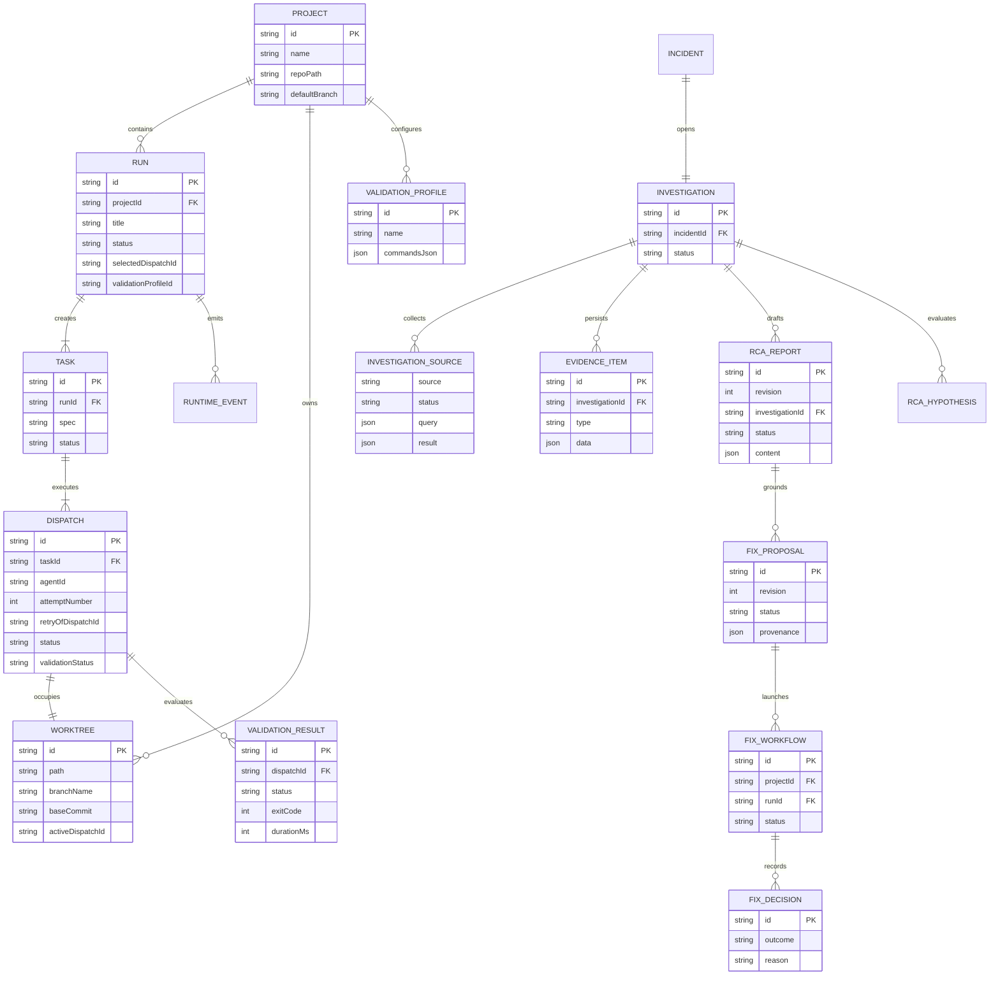
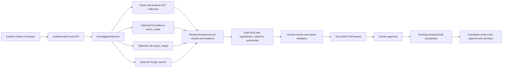

# Relay Technical Architecture & Internals

## 1. System Design

Relay is a **local-first** system split across two cooperating applications:

- **`apps/web`** — React 19 + Vite browser cockpit. Renders the workspace and issues authenticated requests only. Never touches processes, PTYs, or the filesystem directly.
- **`apps/runtime`** — Node.js 22+ Fastify service bound to `127.0.0.1:4400`. Owns process lifecycle, PTYs, Git worktrees, validation execution, and SQLite persistence.
- **`packages/contracts`** — shared Zod schemas; inferred TypeScript types flow to both sides.

```
Browser (React) ──HTTP+Bearer──▶ Fastify API ──▶ Build / Investigate / Fix services ──▶ SQLite
       ▲                                                    │
       └──────── WS /ws/v1 (token) ◀── EventService ◀───────┘
```

**Persist-before-broadcast**: every state transition is committed to SQLite first; only then is a `RuntimeEvent` appended and emitted to WebSocket clients. WebSocket frames are never the source of truth — clients reconcile from HTTP snapshots.

## 2. Domain Entity Relationship



## 3. Key Invariants

1. **Terminal-state immutability** — a dispatch in `succeeded | failed | cancelled | timed_out | lost` never transitions again; the state machine throws `InvalidStateTransitionError`.
2. **Retry = new dispatch** — retries create a fresh dispatch (`attemptNumber + 1`) and a fresh worktree. Late events from the old process cannot mutate the new attempt (stale-event guard in `RunCoordinator.handleProcessExit`).
3. **One writer per worktree** — `worktrees.active_dispatch_id` guards exclusive ownership.
4. **Monotonic event log** — `runtime_events.id` is an autoincrement sequence used for replay and gap detection.
5. **No shell interpolation** — all subprocesses (agents, git, validation) spawn with executable + args arrays.
6. **Agent summary is untrusted** — stored separately, displayed with a warning, never feeds the scorecard label.

## 4. Module Map (runtime)

| Module | Responsibility |
|---|---|
| `persistence/` | SQLite connection (WAL, FK on), migrations, entity repositories |
| `orchestration/event-service.ts` | Append-only event log; emits after commit |
| `orchestration/run-coordinator.ts` | Run creation, fan-out, concurrency drain, stop/retry, exit reconciliation |
| `orchestration/state-machine.ts` | Dispatch transition graph + terminal states |
| `orchestration/run-status.ts` | Pure derivation of run status from dispatches |
| `sessions/process-manager.ts` | node-pty ownership, bounded scrollback (1MB), SIGTERM→SIGKILL stop |
| `agents/` | Adapter contract, probe utils, registry, local CLI adapters + demo fixtures |
| `git/` | Safe git exec wrapper, worktree create/list/diff/guarded-cleanup |
| `validation/` | Profiles, bounded/timed command runner, diff collector, scorecard, candidate selector |
| `investigation/` | Incident intake, read-only Kubernetes and optional Prometheus/Loki/Tempo collection, evidence persistence, deterministic RCA drafts |
| `fix/` | Evidence-grounded proposals, human approval, preflight, Build handoff, and append-only candidate decisions |
| `security/` | Kubernetes read-only guard, telemetry input sanitization, and safe evidence handling |
| `recovery/` | Reconcile interrupted runs and linked fix workflows after runtime restart |
| `evaluation/` | Offline scenario evaluation of recorded investigation/fix outcomes; does not inject cluster faults |
| `server/` | Fastify routes (all under `/api/v1`), auth hook, WS gateway, graceful shutdown |

## 8. Investigate and Fix data flow



The investigation connector runs in the local runtime. Kubernetes collection reads pods, deployments, and events across namespaces and projects only bounded metadata into evidence. Telemetry endpoints are trusted runtime configuration, not browser input. Missing sources are recorded as unavailable; they do not produce fabricated observations. A draft is not a causal determination. Cluster credentials are never passed to coding agents, and candidate selection does not merge or deploy.

Primary investigation API routes:

| Method | Route | Purpose |
|---|---|---|
| `POST` | `/api/v1/investigations` | Collect configured sources and create a draft RCA. |
| `GET` | `/api/v1/investigations/:id` | Read persisted incident, source results, evidence, report, and hypotheses. |
| `POST` | `/api/v1/investigations/:id/reports/:reportId/validate` | Validate a reviewed report revision. |
| `POST` | `/api/v1/rca/investigations/:investigationId/fix-proposals` | Create a proposal from a validated report and persisted evidence. |

See [`docs/INVESTIGATION_CONNECTORS.md`](docs/INVESTIGATION_CONNECTORS.md) for configuration, limits, and the manual smoke test.

## 5. Process & Terminal Lifecycle

- The runtime owns PTYs; a browser disconnect **never** kills a process.
- Each session keeps a 1MB rolling scrollback buffer; a reconnecting client receives a `terminal.snapshot` frame before live `terminal.output`.
- Stop is two-stage: `SIGTERM`, then `SIGKILL` after a 5s timeout. A stop request alone never marks completion — the confirmed process exit does.
- On `SIGINT`/`SIGTERM`, the runtime stops accepting requests, broadcasts a shutdown frame, terminates active processes, checkpoints the WAL, and closes SQLite.

## 6. Authoring a New Agent Adapter

Implement `AgentAdapter` in `apps/runtime/src/agents/adapters/your-agent.ts`:

```typescript
import type {
  AgentAdapter, AgentCapabilities, AgentLaunchRequest,
  AgentLaunchSpec, AgentProbeResult,
} from '../types.js';

export class CustomAgentAdapter implements AgentAdapter {
  readonly id = 'custom';
  readonly displayName = 'Custom Agent';
  readonly defaultBinary = 'custom-agent';

  getCapabilities(): AgentCapabilities {
    return {
      interactiveTerminal: true, oneShotPrompt: true, sendInput: true,
      stopProcess: true, resumeSession: false, structuredOutput: false,
      modelSelection: false, permissionModes: false,
    };
  }

  async probe(): Promise<AgentProbeResult> { /* find binary + --version */ }

  async buildLaunchSpec(req: AgentLaunchRequest): Promise<AgentLaunchSpec> {
    return {
      executable: 'custom-agent',
      args: ['--task', req.taskPrompt ?? ''],   // array — never a shell string
      cwd: req.worktreePath,
      env: req.envOverrides ?? {},
      terminal: true,
    };
  }
}
```

Then register it in `apps/runtime/src/agents/registry.ts#registerDefaults()`.

Rules:
- Probe honestly: installed ≠ authenticated.
- Never claim capabilities the CLI doesn't have — the UI gates controls on them.
- Never interpolate user text into command strings.

## 7. Frontend State

- **Zustand** holds local UI state: connection (in-memory token), selected project, active run/view, selected dispatch tab.
- **TanStack Query** caches server state; a global WS listener invalidates `run`/`scorecard` queries on `dispatch.status`, `run.status`, and `validation.command.finished`.
- **Refresh resilience**: the active run id is mirrored into `?run=<id>` in the URL; reload restores it from the runtime snapshot.
