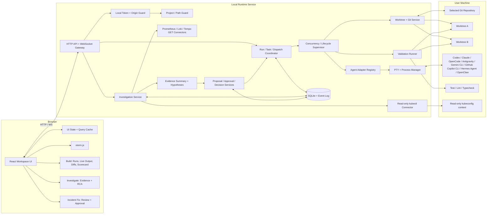

# Relay

Relay is a local-first engineering cockpit with two connected workflows: **Build** runs coding agents in isolated Git worktrees and compares their changes; **Investigate** gathers read-only Kubernetes and optional telemetry evidence, drafts an RCA, and can hand a reviewed report into a gated fix workflow.

## Quick start

Requirements: Node.js 22, pnpm, Git, and at least one supported agent CLI. Install and authenticate each agent separately.

```sh
git clone <repository-url>
cd rocky
nvm use
pnpm install
pnpm dev
```

Open `http://localhost:5173`. Copy the runtime token printed in the terminal and enter it in the connection screen. The runtime listens on `http://127.0.0.1:4400`.

To pin Kubernetes investigations to a kubeconfig context, set it before starting Relay:

```sh
RELAY_KUBERNETES_CONTEXT=kind-local pnpm dev
```

The runtime uses local `kubectl` credentials and performs read-only collection. Prometheus, Loki, and Tempo are optional; without configured endpoints, their source status is `unavailable` and the investigation is typically `partial`.

If Node 22 is installed with Homebrew on macOS:

```sh
export PATH="/opt/homebrew/opt/node@22/bin:$PATH"
```

## Run a task

1. In **Workspace**, register or select a Git repository.
2. Enter the task in **Coding Task Prompt**.
3. Select one or more installed agents. Each selected agent gets the same prompt and a separate worktree based on the same starting commit.
4. Choose a validation profile if you want Relay to run checks after an agent finishes. Set the concurrency limit, then select **Launch Race to Green**.
5. Open **Live Run** to follow agent status and terminal output.
6. Open the scorecard to review each result, diff, and validation evidence. Select **Keep Candidate** for the version you want to retain. Relay does not merge candidates automatically.

Multiple agents work independently; they do not share changes. Relay starts up to the configured concurrency limit (default 3, maximum 5). Most CLI agents automatically execute the supplied task. Antigravity starts an interactive session with the task prompt; exit that session when finished so Relay can finalize the dispatch and run validation.

## Investigate an incident

1. Open **Investigate** and enter an incident title, impact summary, service identifier, severity, and start time.
2. Select a service identifier matching a Kubernetes `app` or `app.kubernetes.io/name` label. Relay collects matching pod, deployment, and event data with read-only requests.
3. Review each source status and the bounded evidence, then review the RCA draft and its competing hypotheses.
4. Validate the cited report only after human review. A validated report can be used to create a fix proposal under **Incident Fix**.
5. Review and approve the proposal before preflight or launch. Fix execution reuses the Build workflow's project, agent, validation, and worktree controls.

RCA output is a deterministic evidence summary, not an automated causal finding. A healthy system pod such as Kind's `kindnet` is useful for checking connectivity, but is not a meaningful incident to approve as a root cause. Full telemetry-backed RCA requires at least one configured Prometheus, Loki, or Tempo endpoint. See [connector configuration and limits](docs/INVESTIGATION_CONNECTORS.md) and the [incident-to-fix runbook](DEMO_INCIDENT_FIX.md).

## Runtime architecture



Kubernetes/telemetry evidence is collected by the local runtime and persisted with the investigation. Build agents receive only the reviewed proposal/evidence references; they do not receive cluster credentials or direct cluster access.

## Supported agents

Relay uses installed and authenticated local CLIs:

| Agent | Command |
|---|---|
| OpenAI Codex | `codex` |
| Claude Code | `claude` |
| OpenCode | `opencode` |
| Antigravity | `agy` |
| Gemini CLI | `gemini` |
| GitHub Copilot CLI | `copilot` |
| Hermes Agent | `hermes` |
| OpenClaw | `openclaw` |

The deterministic `demo-winner` and `demo-loser` fixtures are available with `RELAY_DEMO_MODE=true`.

## Useful commands

```sh
pnpm dev          # Start runtime and web app
pnpm typecheck    # Type-check workspace packages
pnpm test         # Run runtime tests
pnpm build        # Build contracts, runtime, and web app
```

To start the app with a known local development token:

```sh
RELAY_AUTH_TOKEN=mytoken pnpm dev
```

Then enter `mytoken` in the connection screen. Do not commit real credentials.

## Demo mode

Start the runtime with fixture agents, then prepare and register the demo repository from another terminal:

```sh
RELAY_DEMO_MODE=true RELAY_AUTH_TOKEN=mytoken pnpm --filter @relay/runtime dev
./scripts/prepare-demo.sh mytoken
pnpm --filter @relay/web dev
```

In the UI, select the registered `demo-project`, choose **Node Test Suite**, select both demo agents, and launch the run.

## Runtime settings

| Variable | Default | Purpose |
|---|---|---|
| `RELAY_AUTH_TOKEN` | Random token | Runtime API and WebSocket authentication. |
| `RELAY_DEMO_MODE` | `false` | Enable deterministic demo agents. |
| `RELAY_HOST` | `127.0.0.1` | Runtime bind address. |
| `RELAY_PORT` | `4400` | Runtime port. |
| `ALLOWED_ORIGIN` | `http://localhost:5173` | Allowed web app origin. |
| `RELAY_KUBERNETES_CONTEXT` | Current kubectl context | Optional kubeconfig context for read-only Kubernetes collection. |
| `KUBECTL_PATH` | `kubectl` on `PATH` | Optional kubectl executable path. |
| `RELAY_PROMETHEUS_URL` | Unset | Optional Prometheus base URL. |
| `RELAY_LOKI_URL` | Unset | Optional Loki base URL. |
| `RELAY_TEMPO_URL` | Unset | Optional Tempo base URL. |
| `RELAY_TELEMETRY_BEARER_TOKEN` | Unset | Optional bearer token for telemetry GET requests. |

Keep the runtime bound to loopback for local use. Relay stores runs, investigations, evidence, reports, proposals, and decisions locally in SQLite. It does not store provider credentials. Telemetry endpoints must be configured in the trusted local runtime, never supplied by browser input.

## Troubleshooting

- **UI says the runtime or scorecard endpoint failed / Vite reports `ECONNREFUSED 127.0.0.1:4400`:** start or restart the runtime in a separate terminal and keep it open. If the runtime generated a new auth token, reconnect the browser with that token.
- **Investigation is `partial`:** inspect source statuses. Kubernetes can succeed while unconfigured Prometheus, Loki, or Tempo sources report `unavailable`.
- **OpenCode says a model is unsupported:** select an enabled `provider/model` in OpenCode and configure its default for the local CLI. Relay launches the installed CLI; it does not provide model hosting or billing.

## Implementation status

See the [acceptance matrix](ACCEPTANCE_MATRIX.md) for verified coverage and remaining work. The implementation-gap report records the current state of Build, Investigate, and Incident Fix. `implimentation.md` is the original Build-focused product specification; the investigation/fix extension is documented in the runtime architecture and connector runbook.
