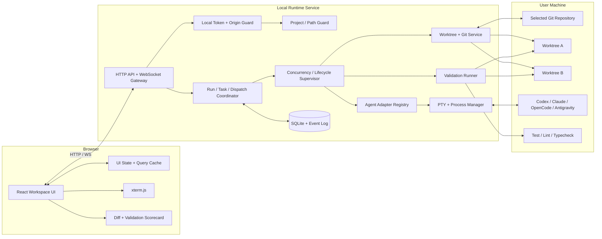

# Relay — Browser-First Multi-Agent Coding Cockpit

> **Implementation specification for an autonomous coding agent**  
> Status: MVP contract  
> Product type: Local-first browser UI + local runtime service  
> Primary goal: Coordinate Codex, Claude Code, OpenCode, and Antigravity from one browser workspace; run agents side-by-side in isolated Git worktrees; compare their implementations using real validation results.

---

## 0. Instructions to the implementation agent

Build the product described here. Treat this file as the source of truth when implementation details are not yet present in the repository.

1. **Inspect the existing repository before changing it.** Preserve working code, package conventions, scripts, and lint/test configuration. Do not replace a working project with a fresh scaffold just because the architecture below suggests a directory layout.
2. Implement end-to-end slices. A button that only changes mock state is not complete when its name implies it launched, stopped, retried, validated, or merged an agent task.
3. Use TypeScript for the web app and local runtime. Keep the browser UI separate from privileged process and filesystem operations.
4. Do not copy Orca source files wholesale. Take architectural inspiration from its worktree isolation, agent adapters, terminal sessions, durable task/dispatch lifecycles, and recovery concepts. If any code is copied from Orca, comply with its MIT license and preserve required notices.
5. Do not fake a provider capability. Detect available CLIs, inspect their installed versions/help when needed, and show unsupported operations as disabled with an explanation.
6. Do not claim an agent succeeded because it printed “done.” Record process exit, changed files, and validation results separately from the agent’s self-reported summary.
7. Keep the MVP deliberately narrow. Do not implement a full general-purpose IDE, mobile companion, cloud account system, custom model gateway, or automatic production deployment.
8. Add tests with each slice. Keep the app runnable at the end of each milestone.

### Definition of done

The MVP is done only when a user can open the app in a browser, select a local repository, detect the configured agent CLIs, run at least two supported agents concurrently on separate worktrees, see live output, stop/retry a session, inspect each candidate’s diff, run the same validation commands on every candidate, and choose which candidate to keep. A demo mode may use seeded data for UI development, but the final demo must also prove real runtime execution.

---

## 1. Product definition

### 1.1 Product name

**Relay** is a provisional name for a browser-first multi-agent engineering cockpit.

### 1.2 Problem

Developers increasingly use several coding agents, but switching among separate terminals and IDEs makes concurrent work difficult to supervise. Prompts, working directories, running processes, diffs, and test outcomes become fragmented. Running agents in the same checkout can cause file conflicts or misleading comparisons.

### 1.3 Product promise

One browser workspace for launching, supervising, and comparing multiple coding agents against the same task—with isolation and objective validation built into the workflow.

### 1.4 Differentiation: verified parallel execution

The flagship workflow is **Race to Green**:

1. Choose a repository and enter a coding task.
2. Select two or more installed agents.
3. Relay creates a separate Git worktree and branch for each agent.
4. Each agent receives the same task prompt and repository context.
5. Relay streams status and output for every dispatch.
6. When agents finish, Relay runs the same configured validation commands against each worktree.
7. Relay compares test results, type-check/lint results, duration, changed files, and diffs in one scorecard.
8. The user reviews evidence and chooses a candidate to keep or merge.

The product must not describe an implementation as “best” solely because its agent claimed success. Show the underlying checks and let the user make the final choice.

### 1.5 Product principles

- **Browser-first, not browser-only:** browser UI; local runtime handles local CLIs, Git, and PTYs.
- **Isolation by default:** one active dispatch owns one worktree unless the user explicitly attaches a session to an existing workspace.
- **Control over magic:** status and actions must correspond to actual backend state.
- **Evidence over confidence:** validation results are distinct from agent summaries.
- **Agent-neutral core:** provider-specific details live behind adapters.
- **Human-controlled integration:** never merge or overwrite work automatically without a clear user action.
- **Recoverable execution:** session events, task state, and results survive a browser refresh and ordinary runtime restart where practical.

---

## 2. Scope and priorities

### 2.1 P0 — required in the hackathon MVP

- Browser app built with React + TypeScript + Vite.
- Local Node.js runtime service with HTTP and WebSocket APIs.
- Project/repository picker for directories selected by the user.
- Agent status and configuration screen.
- Agent switching: move among live sessions without losing their distinct output, working directory, or state.
- Adapter layer for Codex, Claude Code, OpenCode, and Antigravity CLI (`agy` where supported by the installed release).
- Live terminal/output panel with start, send input where supported, stop, reconnect, and restart actions.
- Create/list/delete-safe Git worktrees (deletion must be guarded when uncommitted work exists).
- Run/task/dispatch tracking with explicit lifecycle states.
- Run the same validation command set across selected candidate worktrees.
- Diff summary per candidate and candidate comparison/scorecard.
- Durable local state for runs, tasks, dispatches, and validation results.
- Localhost-only security defaults and tests for the major safety boundaries.
- A deterministic demo fixture and a real end-to-end demo script.

### 2.2 P1 — add only after P0 is reliable

- Task dependencies and simple DAG scheduling.
- Decision gates for actions requiring user approval.
- Structured output parsing for adapters that support it.
- Resume a provider session when the provider CLI supports reliable resumption.
- Open a file/diff in a lightweight editor or Monaco view.
- More custom CLI adapters.
- Export a run report as Markdown/JSON.

### 2.3 Explicitly out of scope for MVP

- Rebuilding Orca’s complete IDE or Electron shell.
- Mobile companion apps.
- Remote SSH/federated execution workers.
- Browser computer-use automation.
- Native GitHub/Linear clients.
- Complex account/organization administration.
- Model provider/API-key aggregation or billing management.
- Automatic production remediation.
- Automatic merge without confirmation.
- Running arbitrary shell commands from unauthenticated browser requests.
- Guaranteed programmatic control of private/internal provider UI state.

---

## 3. Orca reference: what to learn and what not to copy

Reference repository: <https://github.com/stablyai/orca>

The examined Orca README and package metadata describe a TypeScript-based product with a React/Vite web surface alongside Node/Electron runtime components. Relevant package choices include React, Vite, Tailwind CSS, `lucide-react`, `zod`, `ws`, `node-pty`, and xterm-related packages. Orca is much broader than Relay and includes desktop/mobile and platform-specific runtime features; these are not required in this browser MVP.

Reference docs worth studying:

- [Orca README and feature overview](https://github.com/stablyai/orca/blob/main/README.md)
- [Orca orchestration model](https://github.com/stablyai/orca/blob/main/docs/site/content/docs/cli/orchestration.mdx)
- [Orca package manifest](https://github.com/stablyai/orca/blob/main/package.json)
- [Orca worktree guide](https://www.onorca.dev/docs/model/worktrees)
- [Orca terminal guide](https://www.onorca.dev/docs/terminal)

### 3.1 Patterns to adapt

1. **Adapter-based agent launching:** provider-specific behavior must not leak into common UI components.
2. **Isolated Git worktrees:** parallel agents need independent checkouts and branches.
3. **Task and dispatch distinction:** a task describes desired work; a dispatch represents one particular attempt to perform it. Retries create new dispatches.
4. **Explicit lifecycle state:** running, waiting, succeeded, failed, cancelled, and blocked must be derived from runtime events and process state.
5. **Worker supervision and recovery:** retain logs, record failures, support stop/retry, and prevent a stale process from marking a newer attempt complete.
6. **Terminal persistence:** a browser refresh must not kill the process; the runtime owns the PTY, while the UI attaches and renders output.
7. **Receipts/evidence:** display what was launched, where it ran, which files changed, and which checks passed.

### 3.2 Patterns not to reproduce in MVP

Do not recreate Orca’s broad native app, remote host management, mobile pairing, complex terminal engine, numerous integrations, or complete design-mode tools. Use well-supported browser packages and make the control plane small. Do not assume Orca’s architecture is all client-side: launching local CLIs requires a privileged local runtime boundary.

---

## 4. Critical runtime constraint: browser UI requires a local service

A normal web page cannot directly spawn `codex`, `claude`, `opencode`, or `agy`, execute Git commands against arbitrary local paths, or create native PTY sessions. Therefore Relay must have two cooperating applications:

1. **Web frontend** — renders the workspace and issues authenticated requests.
2. **Local runtime service** — runs on the developer’s machine, owns process lifecycle, PTYs, filesystem access, and Git worktrees.

For the hackathon, the user starts the runtime locally and opens the Vite app in a browser. In production, the frontend can be bundled/served by the runtime or hosted separately, but a hosted frontend still needs a trusted agent runtime on the machine or remote host where the repository and CLIs live.

### 4.1 Local connection model

- Bind the runtime to `127.0.0.1` by default, not `0.0.0.0`.
- Use a random local bearer token created at startup. Do not put provider API keys in browser local storage.
- Configure the exact allowed frontend origin(s); reject unexpected CORS origins.
- Require the bearer token for every mutating API and WebSocket connection.
- Display runtime connectivity and version in the frontend.
- If the runtime is unavailable, show an actionable connection state; do not silently fall back to fake sessions.

### 4.2 Repository security model

A user explicitly chooses one or more allowed repository roots. The runtime resolves real paths and rejects path traversal, symlink escapes, and operations outside the allowlist. Git and process operations must use argument arrays with `shell: false` where applicable. Never interpolate user task text into shell command strings.

---

## 5. Recommended stack

Prefer versions compatible with the current repo and toolchain. Do not upgrade major dependencies without a reason.

| Layer | Recommendation | Reason |
|---|---|---|
| Package management | `pnpm` workspace | Similar monorepo workflow to Orca; one lockfile and shared types |
| Language | TypeScript, strict mode | Share contracts between frontend and runtime |
| Frontend | React 19 + Vite | Same general web UI foundation as Orca |
| Styling | Tailwind CSS v4 + CSS variables | Fast, consistent UI iteration; theme tokens |
| Icons | `lucide-react` | Lightweight consistent icon family |
| UI state | Zustand | Small client-side state for selected project/session/layout |
| Server-data state | TanStack Query (optional) | Query invalidation/reconnect handling; do not add if existing conventions cover this |
| Local runtime | Node.js + TypeScript | Process and filesystem access on the user machine |
| HTTP + realtime | Fastify (or a minimal existing HTTP server) + WebSocket (`ws`) | Typed local API and streamed status/output |
| Validation | Zod | Validate all API input and events at runtime |
| PTY | `node-pty` | Interactive terminal integration for CLI agents |
| Terminal renderer | xterm.js + fit addon | Render ANSI output in the browser |
| Git/worktrees | Git CLI via safe `spawn` calls | Stable Git worktree/branch semantics |
| Persistence | SQLite with a small repository/data-access layer | Durable run and dispatch state; keep SQL behind a service boundary |
| Diff display | `git diff` output + syntax-highlighted renderer; Monaco optional | P0 needs reviewable diffs, not a full editor |
| Tests | Vitest + Testing Library + Playwright | Unit, component, and end-to-end contracts |
| Quality | ESLint/Oxlint equivalent, Prettier/Oxformat equivalent, TypeScript checks | Keep type/lint/test commands explicit |

**Avoid overengineering:** SQLite is enough for a local MVP. Do not add Redis, Kafka, Kubernetes, a separate orchestration database, or a distributed queue. The runtime can supervise a few concurrent processes directly.

### 5.1 Runtime/toolchain requirements

- Node.js 22+ or the version required by selected dependencies; verify compatibility and pin the actual tested version in `.nvmrc`/`engines`.
- Git installed and callable.
- At least one supported agent CLI installed and authenticated.
- `node-pty` native build support for the user’s OS; include an installation diagnostic and clear error.

---

## 6. High-level architecture



### 6.1 Component responsibilities

**Web app**
- Renders projects, agent registry, sessions, runs, worktrees, diffs, and validation evidence.
- Sends commands only through the local runtime API.
- Subscribes to runtime events and applies state updates idempotently.
- Does not invoke shell commands or access arbitrary local paths.

**API/WebSocket gateway**
- Authenticates every connection and request.
- Validates payloads with Zod.
- Maps requests to service methods; it must not contain Git or provider-specific logic itself.
- Enforces request sizes, event backpressure, and session ownership.

**Orchestration coordinator**
- Owns durable Runs, Tasks, and Dispatch records.
- Creates dispatch attempts, checks concurrency limits, and reconciles process exit with state.
- Prevents a stale dispatch from mutating a newer attempt.
- Emits state-change events only after persistence succeeds.

**Agent registry/adapters**
- Detect installed CLIs, discover version/capabilities, build safe launch configurations, launch sessions, send input, and stop/restart processes where supported.
- Hide differences among CLI commands and output formats behind a common contract.

**PTY/process manager**
- Owns PTYs after creation, even when no browser is attached.
- Streams terminal data and exit events to subscribers.
- Keeps bounded scrollback and logs; handles process trees, cleanup, disconnects, and runtime shutdown.

**Git/worktree service**
- Creates unique branch/worktree pairs from a selected repository and base commit.
- Guarantees one active writer dispatch per worktree.
- Calculates changed files, diff stats, status, and merge feasibility.
- Never silently overwrites user changes or automatically merges unvalidated changes.

**Validation runner**
- Runs user-configured validation commands in a selected worktree with timeouts and output limits.
- Records command, exit code, duration, bounded stdout/stderr, and status.
- Applies identical commands to candidate worktrees during a comparison run.

**Persistence layer**
- Stores durable entity snapshots and append-only runtime events.
- Does not store provider secrets. Avoid storing full environment dumps.

---

## 7. Suggested repository layout

Adapt this to an existing repository rather than blindly restructuring it.

```text
relay/
├── apps/
│   ├── web/                         # React + Vite browser app
│   │   ├── src/
│   │   │   ├── app/                 # router, app shell, providers
│   │   │   ├── components/          # shared UI primitives
│   │   │   ├── features/
│   │   │   │   ├── projects/
│   │   │   │   ├── agents/
│   │   │   │   ├── sessions/
│   │   │   │   ├── runs/
│   │   │   │   ├── worktrees/
│   │   │   │   ├── diffs/
│   │   │   │   └── validation/
│   │   │   ├── hooks/
│   │   │   ├── stores/
│   │   │   ├── lib/                 # API + WebSocket client
│   │   │   └── styles/
│   │   └── vite.config.ts
│   └── runtime/                     # Local Node service
│       └── src/
│           ├── server/              # HTTP routes / WS gateway
│           ├── auth/
│           ├── config/
│           ├── projects/
│           ├── agents/
│           │   ├── types.ts
│           │   ├── registry.ts
│           │   └── adapters/
│           │       ├── codex.ts
│           │       ├── claude.ts
│           │       ├── opencode.ts
│           │       ├── antigravity.ts
│           │       └── generic-cli.ts
│           ├── sessions/            # PTY/process ownership
│           ├── git/                 # repo and worktree services
│           ├── orchestration/        # Run / Task / Dispatch
│           ├── validation/
│           ├── persistence/
│           └── index.ts
├── packages/
│   └── contracts/                   # Shared Zod schemas + inferred types
├── tests/
│   ├── fixtures/
│   ├── integration/
│   └── e2e/
├── data/                            # local runtime data; gitignored
├── package.json
├── pnpm-workspace.yaml
├── .env.example
├── .gitignore
└── README.md
```

Do not place process-launch code in `apps/web`. Do not import Node modules into the browser bundle. Shared contracts must be browser-safe.

---

## 8. Domain model and state machine

Use Zod schemas as the contract between HTTP, WebSocket, database serialization, and frontend types. Inferred TypeScript types should come from the shared schemas.

### 8.1 Entities

**Project**
- `id`: UUID
- `name`: display name
- `repoPath`: canonical absolute path, only from an explicit user selection
- `defaultBranch`: detected base branch
- `createdAt`, `updatedAt`

**AgentInstallation**
- `id` / `agentId`: stable identifier such as `codex`, `claude`, `opencode`, `antigravity`
- `displayName`
- `binaryPath`
- `installed`: boolean
- `version`: nullable string
- `capabilities`: object describing verified capabilities
- `lastProbeAt`
- `diagnostic`: safe user-readable detail; never include secrets

**Worktree**
- `id`, `projectId`, `path`, `branchName`, `baseCommit`
- `status`: `ready | dirty | active | cleanup_pending | removed | error`
- `activeDispatchId`: nullable
- `createdAt`, `updatedAt`

**Run**
- `id`, `projectId`, `title`, `objective`
- `status`: `draft | queued | running | waiting | completed | failed | cancelled | partial`
- `createdAt`, `startedAt`, `finishedAt`
- Optional: `validationProfileId`, `concurrencyLimit`

A Run groups attempts for one comparison or orchestration objective. It does not directly own a process.

**Task**
- `id`, `runId`, `title`, `spec`, `status`
- `dependencies`: task IDs, empty for MVP by default
- `createdAt`, `updatedAt`
- Optional `resultSummary`

Task statuses: `pending | ready | dispatched | completed | failed | blocked | cancelled`.

**Dispatch**
- `id`, `taskId`, `attemptNumber`, `agentId`, `worktreeId`, `processId`/`sessionId`
- `status`: `queued | starting | running | waiting_input | stopping | succeeded | failed | cancelled | timed_out | lost`
- `startedAt`, `finishedAt`, `exitCode`, `errorCode`
- `agentSummary` (untrusted/display-only), `lastHeartbeatAt`
- `baseCommit`, `headCommit` when available
- `validationStatus`: `not_run | running | passed | failed | partial`

Each retry creates a **new Dispatch** with an `attemptNumber` and `retryOfDispatchId`. Never reuse a dispatch ID for a new process attempt.

**RuntimeEvent**
- `id` monotonically increasing sequence per runtime database
- `timestamp`
- `type`
- `projectId`, optional `runId`, `taskId`, `dispatchId`, `sessionId`
- `payload` validated against event type

**ValidationProfile**
- `id`, `projectId`, `name`
- `commands`: ordered list of `{ id, label, executable, args, cwdMode, timeoutMs }`
- `cwdMode` should be relative to worktree root for this MVP
- Store executable and args as separate fields; no shell interpolation by default.

**ValidationResult**
- `id`, `dispatchId`, `commandId`, `status`, `exitCode`, `durationMs`
- Bounded `stdout`, `stderr`; `startedAt`, `finishedAt`

**Artifact**
- `id`, `dispatchId`, `kind`: `summary | diff | test_output | metadata`
- `path` or bounded `content` as appropriate
- `createdAt`

### 8.2 Invariants

1. Every dispatch belongs to exactly one task and one agent installation.
2. A dispatch may write to at most one worktree.
3. A worktree cannot be attached to two concurrent writer dispatches.
4. A retry is a new dispatch and cannot be completed by the old attempt’s delayed event.
5. A dispatch may transition to a terminal state only once.
6. `succeeded` means the agent process ended with success according to adapter semantics; it does **not** mean tests passed.
7. Validation has its own state and recorded result.
8. Merge/keep decisions must reference a known project/worktree and current base commit. Detect a changed base or stale diff and require re-review.
9. All status mutations go through services, not direct renderer writes to a database.
10. Persist a state transition before broadcasting it to clients.

### 8.3 State transition guidance

`queued -> starting -> running`

From `running`, the dispatch can move to `waiting_input`, `stopping`, `succeeded`, `failed`, `timed_out`, `cancelled`, or `lost` as supported by real events. `waiting_input -> running` occurs on input/resume if the adapter supports it. `stopping -> cancelled` only after the process is confirmed stopped; a stop request alone is not completion. On runtime restart, reattach to known surviving processes if supported; otherwise mark unrecoverable sessions `lost` with a clear recovery action. Do not mark every persisted `running` session as running after a crash without probing the process.

---

## 9. Agent adapter architecture

### 9.1 Common adapter contract

Create a typed contract similar to the following (adapt names to repo style):

```ts
export type AgentId =
  | "codex"
  | "claude"
  | "opencode"
  | "antigravity"
  | "custom";

export interface AgentCapabilities {
  interactiveTerminal: boolean;
  oneShotPrompt: boolean;
  sendInput: boolean;
  stopProcess: boolean;
  resumeSession: boolean;
  structuredOutput: boolean;
  modelSelection: boolean;
  permissionModes: boolean;
}

export interface AgentLaunchRequest {
  projectPath: string;
  worktreePath: string;
  taskPrompt?: string;
  mode: "interactive" | "one-shot";
  model?: string;
  permissionMode?: string;
  envOverrides?: Record<string, string>;
}

export interface AgentLaunchSpec {
  executable: string;
  args: string[];
  cwd: string;
  env: Record<string, string>;
  terminal: boolean;
  outputParser?: "plain" | "json-lines" | "provider-specific";
}

export interface AgentAdapter {
  id: AgentId;
  displayName: string;
  probe(): Promise<AgentProbeResult>;
  getCapabilities(): AgentCapabilities;
  buildLaunchSpec(request: AgentLaunchRequest): Promise<AgentLaunchSpec>;
  parseExit?(exitCode: number | null, signal: string | null): AgentExitResult;
  parseOutput?(chunk: string): AgentOutputEvent[];
  buildResumeSpec?(request: AgentResumeRequest): Promise<AgentLaunchSpec>;
}
```

This is a design contract, not a demand to reproduce the exact interface. Use a separate `ProcessManager` for spawning and stopping processes; adapters must not directly mutate database records.

### 9.2 Provider integration rules

Implement one adapter per provider and verify its behavior against the installed CLI version. Official CLI interfaces can change; do not assume all providers share flags or prompt-input semantics.

- **Codex**: probe executable and version; support a PTY session where reliable and a non-interactive task mode where documented by the installed version. Respect its own authentication and sandbox/approval configuration.
- **Claude Code**: probe executable/version; interactive mode and print/non-interactive mode have different behavior and capabilities. Do not conflate a one-shot invocation with a long-lived interactive session.
- **OpenCode**: probe CLI; its documented `run` mode can be used for automation, while the normal CLI can run a terminal UI. Treat server-backed/session functionality as capability-gated, not required for P0.
- **Antigravity**: current documentation identifies the terminal CLI as `agy`; probe that binary and its current CLI help/version before building launch arguments. Do not assume that an executable called `antigravity` exists.
- **Generic CLI**: optional P1. Allow only an explicitly configured executable and argument template; do not offer arbitrary untrusted shell snippets as an adapter.

Official documentation references:
- Codex CLI: <https://developers.openai.com/codex/cli/>
- Claude Code CLI usage: <https://docs.anthropic.com/en/docs/claude-code/cli-usage>
- OpenCode CLI: <https://opencode.ai/docs/cli/>
- Antigravity CLI overview: <https://www.antigravity.google/docs/cli/overview/>
- Antigravity CLI reference: <https://www.antigravity.google/docs/cli/reference/>

### 9.3 Capability discovery

Do not show every toggle as enabled for every provider. Probe and store a capability matrix. At minimum the UI should distinguish:

- Installed / missing / probe failed.
- Version detected / version unknown.
- Interactive launch supported.
- One-shot task submission supported.
- Reliable input sending supported.
- Stop supported.
- Resume supported.
- Structured completion parsing supported.
- Model/effort override supported.

A control that is unsupported must be disabled and include a short reason. A successful `--version` probe proves installation, not authentication or that an actual task will run; surface launch/auth failures separately.

### 9.4 Session model

- Each agent session has a stable Relay session ID separate from provider-internal session IDs.
- Store agent ID, project, worktree, launch mode, start time, process state, and bounded output history.
- A session keeps running when its browser panel is inactive.
- Switching sessions in the UI must not send control characters or terminate the old session.
- Do not pretend to migrate one live conversation between providers. To switch provider, create/select a different session; passing the same task to multiple agents creates separate dispatches.
- If the provider has no programmatic resume, offer “relaunch with last prompt” or “open a new attempt,” clearly distinguished from true session continuation.

### 9.5 Process/PTY lifecycle

- Spawn the approved executable with args as an array and an explicit working directory.
- Use an allowlisted environment; inherit only necessary environment variables. Never serialize the full environment into logs.
- Keep output bounded in memory and on disk; support log truncation and scrollback limits.
- Terminate the process group when stopping a dispatch, with an OS-appropriate graceful-then-forceful strategy and a timeout.
- Detect `exit`, `error`, and runtime disconnect events; persist them before broadcasting.
- Do not automatically kill sessions when the web socket disconnects.
- Browser refresh reattaches by Relay session/dispatch ID.
- Add fake adapters and fake process-manager implementations for tests; tests must not need real provider accounts.

---

## 10. Git and worktree design

### 10.1 Why worktrees are core, not a later polish feature

Parallel agents modifying one checkout contaminate each other’s work and invalidate comparisons. For Race to Green, each dispatch gets its own worktree and branch created from the same base commit.

### 10.2 Worktree creation workflow

1. Confirm selected path is a Git repository and resolve its top-level root.
2. Resolve base branch/commit and confirm it exists.
3. Generate a collision-safe worktree name, for example `relay/<run-short-id>/<agent-id>-<attempt>`.
4. Create worktree under a Relay-managed root adjacent to or within a configurable workspace directory; never create it in an untrusted arbitrary system directory.
5. Capture exact base commit SHA and branch name.
6. Verify the resulting worktree path and Git status before dispatch.
7. Launch the agent with `cwd` set to that worktree.
8. On completion, record `HEAD`, changed files, status, and diff stats.

Use safe argument arrays with `git` rather than building a shell command string. Worktree paths and branch names must be generated/validated internally. Avoid worktree path assumptions that break on spaces in paths or Windows path separators.

### 10.3 Cleanup and preservation

- Never delete a worktree with uncommitted changes without explicit confirmation.
- Prefer “archive candidate”/“keep worktree” over automatic cleanup after completion.
- When cleanup is requested, show changed-file count and whether uncommitted changes would be lost.
- A failed process still may have useful code changes; preserve them by default.

### 10.4 Keep/merge semantics

MVP may offer:
- **Keep candidate**: mark candidate as selected and leave its worktree/branch in place.
- **Open diff**: inspect changes.
- **Merge candidate** (guarded): verify current project base branch has not moved unexpectedly, check for clean target state, run mergeability checks, show summary, require a confirmation dialog, and execute a normal Git merge/fast-forward operation. If conflict occurs, stop and report; do not auto-resolve with an LLM in P0.

The first shippable version can launch with “Keep candidate” and “Open diff” while merge integration remains P1, provided the core comparison works. Do not claim merge support if the UI has only a decorative button.

---

## 11. Run and task orchestration

### 11.1 MVP workflow

A comparison run can fan one task out to a selected set of agents. This is the main orchestration path; a general-purpose agent DAG is not required initially.

1. User selects project, prompt, agents, and validation profile.
2. Runtime creates a Run and Task.
3. It validates agent capabilities and Git repository state before launching anything.
4. It creates a separate worktree and Dispatch for each chosen agent.
5. It starts dispatches up to `concurrencyLimit` (default 3; configurable, with a safe upper cap).
6. It streams statuses and output to the UI.
7. On process completion, it computes diff metadata and optionally runs validation.
8. It updates each dispatch’s result; the Run ends as `completed`, `failed`, `partial`, or `cancelled` based on the actual outcome of all dispatches.
9. It displays a comparison scorecard and waits for the user’s selection.

### 11.2 Retry semantics

- Retry creates a new Dispatch attempt, preserving the old output and results.
- A retry either gets a fresh worktree from the base commit or uses a selected prior worktree only after user confirmation. Default to a fresh worktree for valid comparisons.
- Delayed stdout, exit, or completion events from an old dispatch may be logged but cannot update the new attempt’s state.
- Distinguish “retry same task in new attempt” from “resume existing provider session.”

### 11.3 Human decision gates

P0 requires confirmation before risky operations such as deleting a dirty worktree or merging candidate code. P1 can add explicit task gates (question, options, resolution, and the task blocked until resolved). Do not build a chatty multi-agent coordinator that simply makes up task dependencies.

### 11.4 Observability

Every state transition should produce a typed event. Keep a local timeline containing:

- Run created / cancelled / completed.
- Task created / blocked / completed / failed.
- Worktree create / inspect / cleanup attempt.
- Dispatch queued / started / output received / waiting for input / stopped / exited / timed out.
- Validation started / command completed.
- Candidate selected / merge approved / merge completed or failed.

The timeline should include timestamps and identifiers sufficient to debug failed demos.

---

## 12. Frontend UX and visual direction

### 12.1 Core layout

Aim for a clean, dark developer workspace inspired by the information density of agent-oriented IDEs, but not a pixel-for-pixel replica of Orca.

- **Left rail/sidebar**: projects, saved runs, agents, settings.
- **Top context bar**: current repository, branch/base commit, runtime connection, run status.
- **Main canvas**: task/run overview and session tabs/cards.
- **Terminal/session panel**: streamed output and prompt/input control.
- **Right inspector**: selected agent metadata, worktree, lifecycle, changed files, validation status.
- **Comparison view**: candidate columns/cards with pass/fail checks and links to diffs.

Responsive behavior should support ordinary laptop browser sizes. Terminal controls and run actions should remain visible at a reasonable minimum viewport; do not prioritize mobile design in P0.

### 12.2 Essential screens

**A. First-run / connection setup**
- Runtime connection status.
- One-click copy command/instructions to start the runtime.
- Select/add repository via runtime endpoint.
- Agent installation checklist with detected version, authentication/launch notes, and re-probe button.
- “Continue in demo mode” is allowed for walkthroughs but must be visibly labelled Demo.

**B. Workspace**
- Project name and selected base branch/commit.
- Prompt editor with selected agents.
- Validation profile selector.
- “Run with selected agents” action.
- Parallel concurrency setting.

**C. Live run**
- One item per dispatch with agent name, status, elapsed time, and worktree.
- Click to switch terminal/session.
- Start/stop/retry controls based on actual capability and state.
- Event timeline and readable launch errors.
- Indicate if an agent requires manual input.

**D. Candidate comparison**
- Candidate agent, branch/worktree, process outcome.
- Test/typecheck/lint status; command, duration, exit code.
- Diff file count and additions/deletions.
- Open diff and changed file list.
- Agent summary in a visually distinct area from verified test evidence.
- Keep candidate action; merge action only when implementation is real and guarded.

**E. Agent/settings panel**
- Binary path, detected version, capability matrix, last probe, diagnostic details.
- Workspace root, concurrency, output limits, validation profiles, cleanup policies.

### 12.3 Interaction requirements

- Every click must have a defined state transition or navigate to real functionality.
- Disabled controls explain why they are disabled.
- Loading, empty, error, offline, waiting-for-input, and completed states must all be designed.
- Preserve selected run/session after browser refresh using the backend as source of truth.
- Do not store auth tokens in `localStorage`; prefer an in-memory token flow from the local runtime UI/one-time bootstrap, or a secure local mechanism appropriate for the server design.
- Avoid optimistic UI for destructive actions. Wait for backend confirmation.

### 12.4 UI implementation guidance

- Use accessible semantic elements and keyboard focus states.
- Use CSS tokens for background/surface/border/text/status colors; avoid hard-coded unrelated colors across components.
- Use status icons/labels consistently (`running`, `waiting`, `passed`, `failed`, `cancelled`, `unknown`).
- Use xterm.js for terminal output, but keep process state in the backend.
- Use CSS grid/flexbox for the main shell; do not use a canvas to draw the whole interface.
- Do not create a design-only mock of the agents. Data shown in production views must come from the runtime API.

---

## 13. API contract (proposed)

Prefix all HTTP routes with `/api/v1`. Validate request and response schemas. Use an explicit response envelope, for example `{ "data": ..., "error": null, "requestId": "..." }`.

### 13.1 Health and setup

- `GET /api/v1/health` — runtime version, uptime, DB status, connection info without secrets.
- `GET /api/v1/bootstrap` — initial token-authenticated runtime config and capabilities.
- `GET /api/v1/agents` — known agents, probes, capabilities, installation diagnostics.
- `POST /api/v1/agents/:agentId/probe` — recheck one agent installation.
- `GET /api/v1/projects` — previously selected projects.
- `POST /api/v1/projects` — register a user-selected local path after server validation.
- `GET /api/v1/projects/:projectId` — project details and current Git status.

### 13.2 Worktrees

- `GET /api/v1/projects/:projectId/worktrees` — worktrees known to Relay.
- `POST /api/v1/projects/:projectId/worktrees` — create a managed worktree.
- `GET /api/v1/worktrees/:worktreeId` — status, branch, base commit, diff stats.
- `GET /api/v1/worktrees/:worktreeId/diff` — changed files and diff content with size limits.
- `POST /api/v1/worktrees/:worktreeId/keep` — preserve candidate/branch.
- `POST /api/v1/worktrees/:worktreeId/cleanup` — guarded cleanup; returns confirmation requirement if dirty.

### 13.3 Runs, tasks, dispatches

- `GET /api/v1/runs` — list recent runs.
- `POST /api/v1/runs` — create a comparison run from project, prompt, selected agent IDs, and validation profile.
- `GET /api/v1/runs/:runId` — current run and child task/dispatch snapshot.
- `POST /api/v1/runs/:runId/cancel` — request cancellation; report actual stopping status separately.
- `POST /api/v1/tasks/:taskId/dispatches` — create an explicit dispatch when needed.
- `GET /api/v1/dispatches/:dispatchId` — dispatch, session, worktree, and result summary.
- `POST /api/v1/dispatches/:dispatchId/input` — send input only if supported and session is waiting/running appropriately.
- `POST /api/v1/dispatches/:dispatchId/stop` — graceful stop request; runtime confirms outcome.
- `POST /api/v1/dispatches/:dispatchId/retry` — new attempt, optionally fresh worktree.
- `GET /api/v1/dispatches/:dispatchId/diff` — diff metadata/content.

### 13.4 Validation and selection

- `GET /api/v1/projects/:projectId/validation-profiles`
- `POST /api/v1/projects/:projectId/validation-profiles`
- `POST /api/v1/dispatches/:dispatchId/validate`
- `GET /api/v1/dispatches/:dispatchId/validation-results`
- `POST /api/v1/runs/:runId/select-candidate` — select one completed candidate; it does not merge.
- `POST /api/v1/worktrees/:worktreeId/merge` — P1/guarded merge action, only after explicit user confirmation and fresh status checks.

### 13.5 WebSocket

Use `/ws/v1` with token validation at connection time. Define versioned typed event messages. Example:

```ts
type RuntimeEvent =
  | { type: "dispatch.status"; sequence: number; dispatchId: string; status: DispatchStatus; timestamp: string }
  | { type: "terminal.output"; sequence: number; dispatchId: string; data: string; timestamp: string }
  | { type: "terminal.exit"; sequence: number; dispatchId: string; exitCode: number | null; signal: string | null; timestamp: string }
  | { type: "validation.command.finished"; sequence: number; dispatchId: string; result: ValidationResultSummary; timestamp: string }
  | { type: "worktree.updated"; sequence: number; worktreeId: string; status: WorktreeStatus; timestamp: string }
  | { type: "runtime.error"; sequence: number; code: string; message: string; recoverable: boolean; timestamp: string };
```

Use a monotonically increasing event sequence or cursor so the client can detect gaps and request a fresh snapshot. WebSocket messages are not the durable source of truth: reconnect by querying snapshots and then subscribing again. Bound output chunk size and enforce backpressure to avoid freezing the UI.

### 13.6 API error codes

Use stable codes such as:

- `RUNTIME_UNAVAILABLE`
- `AUTH_REQUIRED`
- `ORIGIN_NOT_ALLOWED`
- `AGENT_NOT_INSTALLED`
- `AGENT_PROBE_FAILED`
- `AGENT_CAPABILITY_UNSUPPORTED`
- `REPOSITORY_NOT_ALLOWED`
- `NOT_A_GIT_REPOSITORY`
- `WORKTREE_BUSY`
- `WORKTREE_DIRTY`
- `DISPATCH_NOT_ACTIVE`
- `VALIDATION_TIMEOUT`
- `PROCESS_START_FAILED`
- `PROCESS_STOP_TIMEOUT`
- `STALE_BASE_COMMIT`
- `CONFLICT_DETECTED`
- `INVALID_STATE_TRANSITION`

Return safe diagnostic messages; retain internal stack traces in local logs, not in browser responses.

---

## 14. Persistence design

Use SQLite behind repository/data-access modules. Include migrations and a schema version. At minimum, tables should represent:

- `projects`
- `agent_installations`
- `worktrees`
- `runs`
- `tasks`
- `dispatches`
- `sessions`
- `runtime_events`
- `validation_profiles`
- `validation_results`
- `artifacts` (optional if diffs/log files are stored on disk)

Use foreign keys and appropriate indexes on project/run/task/dispatch IDs and timestamps. Persist all entity status changes transactionally. For terminal output, keep a bounded log file per session or a capped table; do not write unbounded output into one SQLite row. Record a compact output reference and byte count. Rotate/prune logs with an explicit retention policy.

Never store provider credentials or authentication tokens in tables. A user may have CLI credentials configured in their normal OS environment; Relay should invoke the CLI without reading or displaying secret contents.

---

## 15. Validation engine and scorecard

### 15.1 Validation profiles

A validation profile is a list of ordered commands such as:

1. Install/check dependencies only if explicitly configured.
2. Unit tests.
3. Typecheck.
4. Lint.
5. Build.

For an MVP, let the user configure command + args, timeout, and label. Default templates may be offered for common ecosystems, but do not assume every repository uses the same package manager or command set.

### 15.2 Execution rules

- Run with `cwd` set to the dispatch’s worktree root.
- Use argument arrays with `shell: false` wherever possible; if shell scripts are explicitly supported, make them a separate opt-in path with clear warnings and trusted-project scope.
- Enforce per-command timeout and output cap.
- Capture start/end timestamps and exit code.
- Support cancellation and show `timed_out` separately from `failed`.
- Do not run two validation commands that mutate the same generated assets concurrently within one worktree unless configured.
- Run validation in each candidate’s isolated worktree. The comparison run must use the same validation profile version for every candidate.

### 15.3 Candidate scorecard

Display at least:

- Agent process: succeeded / failed / cancelled / unknown.
- Tests: passed / failed / timed out / not run.
- Typecheck and lint: status for each when configured.
- Validation commands completed / total.
- Duration.
- Changed files, additions, deletions.
- Diff viewer link.
- Agent-provided summary, visibly separated from verified facts.

A simple derived label can be:

- **Validated**: all configured required checks passed.
- **Needs review**: at least one check failed/timed out or no validation profile ran.
- **Execution failed**: agent process did not complete successfully.

Do not call the label a correctness guarantee. Passing tests only demonstrates that the configured tests passed.

### 15.4 Deterministic baseline

Include a tiny example project/task fixture that fails an initial test and can be fixed by a coding agent. Make sure the demo records:

- Base commit.
- Exact prompt.
- Agents launched and their versions.
- Validation profile and results.
- Diffs.
- Final user-selected candidate.

If a live provider is unavailable during judging, provide a visible demo mode with deterministic fixture results, but demonstrate at least one real CLI in the primary pitch whenever possible.

---

## 16. Security and reliability checklist

Treat agent CLIs as powerful local processes. The local bridge is a security boundary, not a convenience wrapper.

### 16.1 Must-have controls

- Bind to loopback only unless an explicit, separately secured remote mode is implemented.
- Random runtime token; no unauthenticated mutating API.
- Exact origin allowlist and safe WebSocket origin checking.
- Canonicalize project/worktree paths and enforce allowlisted roots.
- Use `spawn`/PTY APIs with executable + argument arrays, not shell-concatenated strings.
- Validate every API request and WebSocket event with Zod.
- Apply rate limits or action throttles to process creation and stop requests.
- Apply maximum concurrent dispatches, per-process CPU/time constraints where feasible, output caps, and command timeouts.
- Do not store, echo, or expose process environment secrets.
- Do not auto-enable “skip permissions”/dangerous approval-bypass flags.
- Preserve the provider’s normal permission system. Agent capability flags must reflect actual verified behavior.
- Require explicit user confirmation for dirty worktree deletion and merge.
- Do not let arbitrary web pages send requests to the local runtime. Check CORS, Origin, and token; include DNS-rebinding-resistant host validation if the server accepts hostnames beyond fixed loopback.
- Do not expose terminal data to unrelated browser clients. Associate sessions with authenticated runtime clients.
- Redact secrets/tokens from logs and error strings.

### 16.2 Reliability controls

- Idempotent stop/cancel operations.
- Explicit process startup timeout and health diagnostics.
- Heartbeats or periodic process health checks for long-running sessions.
- WebSocket reconnect with snapshot reconciliation.
- Guard stale events by dispatch ID and attempt number.
- SQLite transactions around critical state transitions.
- Crash recovery that distinguishes reattached, exited, and unrecoverable sessions.
- No unbounded buffers or indefinite retry loops.
- On shutdown, stop accepting new dispatches, persist state, and follow a documented graceful process policy. Do not unexpectedly kill all agent processes without warning.

---

## 17. Testing strategy and acceptance criteria

Write automated tests for the behavior, not just component snapshots.

### 17.1 Unit tests

- Adapter command construction never shells out with interpolated prompt strings.
- Capability probe maps missing binary/version/probe errors correctly.
- Worktree branch names are unique and path-safe.
- One worktree cannot be allocated to two active write dispatches.
- Invalid state transitions are rejected.
- Stale dispatch events cannot update a retry attempt.
- Validation timeout and cancellation produce correct terminal states.
- Output is capped/rotated and secrets are redacted.
- Origin/token/path checks reject untrusted requests.

### 17.2 Integration tests with fakes

- Fake CLI emits output, waits for input, exits zero, exits non-zero, hangs, and spawns a child.
- Runtime emits stable lifecycle events in the expected order.
- Database state and event history remain consistent after stop/retry.
- Worktree creation/error handling is tested against a temporary Git repository.
- Validation commands execute in the requested worktree and produce recorded results.
- WebSocket reconnect receives snapshot plus subsequent new events without duplicate status corruption.

### 17.3 End-to-end test

Using a temporary repository and fake adapters:

1. Register the temporary project.
2. Launch two fake agents into separate worktrees.
3. Observe live output from both.
4. Finish one successfully and fail the other.
5. Run the same validation profile on each candidate.
6. Open diff summaries and select a candidate.
7. Refresh the browser and verify the run/session state is restored.

### 17.4 Acceptance checklist

- [ ] Fresh install/build commands are documented and work.
- [ ] Browser connects to a real local runtime.
- [ ] A missing CLI is clearly shown as unavailable, with install/probe guidance.
- [ ] Codex, Claude Code, OpenCode, and Antigravity have separate adapter modules and real probe coverage; actual supported interactions are capability-gated.
- [ ] At least two real installed agents can run side-by-side in separate worktrees in the target demo environment.
- [ ] Agent switching preserves each session and output.
- [ ] Stop/kill waits for confirmed process outcome, not just button click.
- [ ] Retry creates a new dispatch record.
- [ ] Same validation profile runs on every selected candidate.
- [ ] Failed tests are visible and not represented as success.
- [ ] Candidate diffs can be inspected.
- [ ] The user can keep a candidate without an automatic merge.
- [ ] Dirty worktrees are never deleted silently.
- [ ] State survives browser refresh and the common reconnect path.
- [ ] Tests do not require paid provider credentials.
- [ ] No dangerous permission-bypass flag is enabled by default.
- [ ] No process/filesystem endpoint is accessible without local authentication and path validation.

---

## 18. Implementation phases and task breakdown

The coding agent should work in this order. Do not start by building all UI panels with mocked data and postpone the runtime until the end.

### Phase 0 — repository reconnaissance and architecture spike

**Tasks**
- Inspect repository and write a short implementation note identifying existing stack, entry points, scripts, and decisions to preserve.
- Confirm Node/pnpm versions and native PTY installation support for the development OS.
- Create a minimal runtime health endpoint and a browser page that connects to it.
- Verify WebSocket round-trip with a test event.

**Acceptance**: browser can connect to the local runtime; runtime is loopback-bound and token/origin rules are tested.

### Phase 1 — shared contracts and persistent state

**Tasks**
- Set up shared Zod schemas/types for Project, AgentInstallation, Worktree, Run, Task, Dispatch, Session, ValidationResult, and RuntimeEvent.
- Add SQLite migrations/repositories.
- Add event sequence and transactional state transition service.
- Create UI API/WebSocket client and error envelope types.

**Acceptance**: integration test can create a run/task/dispatch record; a persisted status transition produces a replayable event.

### Phase 2 — process manager and generic fake agent

**Tasks**
- Implement process/PTY manager with spawn, stdout/stderr capture, input, stop, exit, timeout, and bounded output.
- Implement a fake CLI script for deterministic tests.
- Implement live WebSocket terminal streaming and reconnect/snapshot semantics.

**Acceptance**: UI can run/stop a fake process and terminal output continues to be recorded if the tab disconnects.

### Phase 3 — provider probes and adapters

**Tasks**
- Implement capability registry and provider probes.
- Implement Codex, Claude Code, OpenCode, and Antigravity adapter modules.
- Verify command arguments against currently installed CLI help/version and official documentation.
- Build a readable diagnostics page.

**Acceptance**: unavailable CLI is not falsely shown as installed; launch failure is persisted with safe diagnostics; at least one supported provider completes an end-to-end task in the development environment.

### Phase 4 — Git project and worktree service

**Tasks**
- Register and validate a local repository path.
- Detect Git root, branch, HEAD, status, remotes (display only; no network push by default).
- Create worktrees/branches from same base commit.
- Inspect diff/status and implement guarded cleanup.

**Acceptance**: create two worktrees for the same repo; verify paths/branches differ and each worktree is isolated; a dirty worktree cannot be silently deleted.

### Phase 5 — run/task/dispatch coordinator

**Tasks**
- Implement Run creation and fan-out task flow.
- Create a dispatch per chosen agent with unique attempt number and worktree.
- Enforce concurrency cap and worktree exclusive ownership.
- Reconcile process events with persisted state.
- Implement stop and retry semantics.

**Acceptance**: run two fake agents and two real agents in separate worktrees; all dispatch states and old attempts remain inspectable.

### Phase 6 — validation and comparison scorecard

**Tasks**
- Implement validation profiles/commands/timeouts/output limits.
- Capture diff metadata and changed files after dispatch completion.
- Execute same validation profile for all candidates.
- Derive transparent candidate labels from actual checks.
- Add “keep candidate” action.

**Acceptance**: a deterministic fixture produces one passing candidate and one failing candidate; the scorecard shows the real command results and allows user selection.

### Phase 7 — browser UX and finishing polish

**Tasks**
- Build workspace shell, project switcher, agent status, run composer, session tabs, terminal, diff viewer, timeline, and comparison view.
- Add empty/loading/offline/error/waiting/completed states.
- Restore current run and selected session after refresh.
- Add keyboard accessibility and layout checks.

**Acceptance**: a judge can complete the central workflow with no developer tools open and without needing to understand internal IDs.

### Phase 8 — release and demo hardening

**Tasks**
- Add `README.md`, `.env.example`, troubleshooting instructions, and supported platform notes.
- Add one-command development scripts; make shutdown/restart behavior explicit.
- Run unit, integration, e2e, typecheck, lint, and production build.
- Create demo fixture and a repeatable demo checklist.
- Verify clean install on the actual presentation machine.

**Acceptance**: all required P0 checklist items pass, and the demo can be repeated without deleting database state or hand-editing records.

---

## 19. Demo script for the hackathon

Use one small repository with an understandable task and a deterministic validation command.

1. Open Relay in a browser and show that the runtime is connected.
2. Show installed agent probes and select two supported agents.
3. Enter one identical task prompt, choose a validation profile, and start Race to Green.
4. Show both agents running concurrently in their own worktrees and switch between their sessions.
5. Open the run timeline and point out separate statuses/attempt IDs.
6. Let both finish; run the same test/typecheck command on both worktrees.
7. Show one candidate passing and the other failing, or show a measured difference in checks/results.
8. Open the diff and changed files for each candidate.
9. Keep the preferred candidate and show that no merge happened without the user choosing it.
10. Refresh the browser and show the run history and evidence remain available.

If judging time is short, use two agents and one required test suite rather than trying to demonstrate every feature. Show real terminal/process events and actual tests—not just an animated status dashboard.

---

## 20. Risks and decisions

| Risk | Mitigation |
|---|---|
| Agent CLIs differ and change frequently | Adapter interface, capability probes, small provider-specific integration tests |
| Antigravity CLI behavior is different from other agents | Use documented `agy` CLI and installed help/version; gate unsupported controls |
| Browser security prevents native access | Required localhost runtime boundary; do not try to bypass browser sandbox |
| Native PTY package fails on one OS | Verify target OS early; provide clear setup diagnostics and deterministic fake-adapter demo |
| Parallel agents produce incomparable results | Create all worktrees from the same recorded base commit and run one shared validation profile |
| Agent says it succeeded but tests fail | Separate process result, agent summary, and validation result |
| UI state drifts after refresh/disconnect | Runtime is source of truth; event sequence + snapshot reconciliation |
| Dangerous commands or file deletion | Loopback auth, path allowlist, safe process invocation, confirmations, no default permission bypass |
| Scope expands into an IDE clone | Keep file editing, remote execution, mobile, and integrations out of P0 |

### Decisions that should remain configurable

- Worktree root directory.
- Max concurrent dispatches (with conservative hard limit).
- Validation profiles.
- Retention duration/size for terminal logs.
- Whether to preserve completed worktrees (default yes).
- Per-agent command path and supported launch mode.

---

## 21. Expected result at MVP handoff

The deliverable should contain:

- Working browser UI and local runtime service.
- Shared contracts and documented runtime API.
- Four dedicated agent adapters with installation/capability diagnostics, with actual actions enabled only where verified.
- Isolated worktree execution and explicit Run/Task/Dispatch lifecycle.
- Live terminal sessions with session switching and reconnect behavior.
- Diff and validation comparison across candidates.
- Local durable state and event history.
- Safety guards around process creation, repository paths, cleanup, and merging.
- Unit/integration/e2e tests, a deterministic demo fixture, and a repeatable real-agent demo.
- README containing setup, supported agents, limitations, security model, troubleshooting, and demo steps.

**The MVP should optimize for this sentence:** “I can give the same real coding task to multiple agents, see them work independently, and select the candidate that passes the evidence-based checks.”

---

## References

1. Orca repository and feature scope: <https://github.com/stablyai/orca>
2. Orca orchestration model (Run, Task, Dispatch, messages, gates, worker lifecycle): <https://github.com/stablyai/orca/blob/main/docs/site/content/docs/cli/orchestration.mdx>
3. Orca package manifest / stack evidence: <https://github.com/stablyai/orca/blob/main/package.json>
4. OpenAI Codex CLI docs: <https://developers.openai.com/codex/cli/>
5. Claude Code CLI docs: <https://docs.anthropic.com/en/docs/claude-code/cli-usage>
6. OpenCode CLI docs: <https://opencode.ai/docs/cli/>
7. Antigravity CLI overview: <https://www.antigravity.google/docs/cli/overview/>
8. Antigravity CLI reference: <https://www.antigravity.google/docs/cli/reference/>

This is an independent implementation specification inspired by public architectural patterns; it is not an endorsement by or official document of Orca or any listed agent provider.
